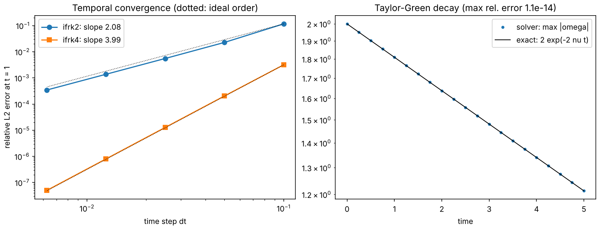

# Neural Fluid Dynamics Simulator (`nfds`)

A verified 2D incompressible Navier–Stokes solver, a reproducible turbulence dataset, and neural
surrogates (CNN → U-Net → Fourier Neural Operator → hybrid) evaluated on accuracy, physical
consistency, long-rollout stability, Reynolds-number generalisation and speed.

**Status: Milestone M0 (foundations) complete.** NumPy reference solver plus a verification suite
of 22 tests.



## Quick start

```bash
python -m venv .venv && source .venv/bin/activate
pip install -e ".[dev]"
pytest -q                                   # verification suite (~5 s)
python scripts/verify.py                    # convergence + Taylor–Green figure
python scripts/demo_decaying.py             # 256² decaying turbulence (~40 s on a laptop CPU)
```

## What is implemented

| Component | File | Notes |
| --- | --- | --- |
| Periodic grid, FFT operators, 2/3 dealiasing | `src/nfds/grid.py` | Fields indexed `[y, x]`; `rfft2` layout |
| Vorticity solver, IF-RK2 / IF-RK4 | `src/nfds/solver/spectral_numpy.py` | Viscosity and drag integrated exactly; CFL-adaptive steps that land on save times |
| Diagnostics | `src/nfds/diagnostics.py` | Energy, enstrophy, palinstrophy, spectrum E(k), resolution ratio |
| Initial conditions | `src/nfds/initial_conditions.py` | Taylor–Green, Gaussian random field, double shear layer, vortex dipole |
| Forcing | `src/nfds/forcing.py` | Kolmogorov forcing with its laminar solution |

### Equations

```
∂ω/∂t + u·∇ω = ν∇²ω − αω + (∇×f)_z,     ∇²ψ = −ω,     u = (∂ψ/∂y, −∂ψ/∂x)
```

on the periodic box [0, 2π)². Linear terms use the integrating factor exp((−νk² − α)Δt); advection
and forcing use Heun (RK2) or classic RK4.

## Verification results

| Test | Result |
| --- | --- |
| Taylor–Green vortex vs exact decay | relative error ~1e-14 |
| Analytic advection term (two-mode streamfunction) | exact to 1e-12 |
| Temporal convergence order | IF-RK2 slope 2.08, IF-RK4 slope 3.99 |
| Spatial convergence | error ratios grow with n (spectral, not algebraic) |
| Inviscid E and Z conservation | drift → 0 as Δt⁵ (pure time-stepping error) |
| Energy and enstrophy budgets (decaying and forced) | residual < 2e-3 |
| Kolmogorov spin-up vs exact laminar solution | relative error < 1e-9 |
| Divergence, mean vorticity | round-off |

## Resolution guidance (measured, see `docs/experiment_log.md`)

At 256², decaying turbulence with initial peak k = 6 is resolved for ν ≳ 1e-3 (energy near the
dealiasing cutoff ~2e-5 of the peak). ν = 1e-4 is clearly under-resolved at 256² (~1e-3, with
visible grid-scale noise). Always check `resolution_ratio` before trusting a run.

## Repository layout

```
src/nfds/        package: grid, solver, diagnostics, initial conditions, forcing
tests/           verification suite (runs in CI)
scripts/         figure and demo scripts
figures/         committed verification figures
docs/            experiment log
```

## Roadmap

- [x] **M0** Foundations: repo, CI, NumPy reference solver, verification suite
- [ ] **M1** Batched PyTorch (GPU) solver, tested against the NumPy reference
- [ ] **M2** Dataset pipeline (generator CLI, HDF5/Zarr, splits, datasheet)
- [ ] **M3** Baselines, CNN, U-Net
- [ ] **M4** Fourier Neural Operator
- [ ] **M5** Stability and generalisation study
- [ ] **M6** Interactive frontend
- [ ] **M7** Report and stretch goal
