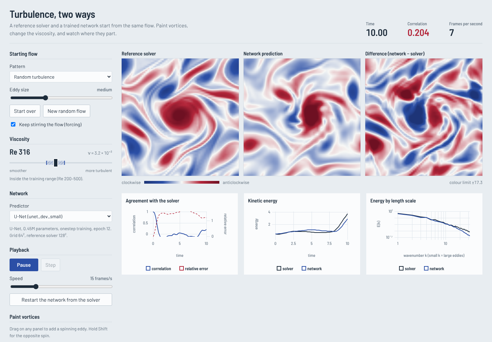

# Neural Fluid Dynamics Simulator (`nfds`)

A verified 2D incompressible Navier–Stokes solver, a reproducible turbulence dataset, and neural
surrogates (CNN → U-Net → Fourier Neural Operator → hybrid) evaluated on accuracy, physical
consistency, long-rollout stability, Reynolds-number generalisation and speed.

**Status: milestones M0–M4 and M6 complete; M5 tooling complete and dry-run, with the full study
ready to run on a GPU ([docs/GPU_RUNBOOK.md](docs/GPU_RUNBOOK.md)).** Verified solvers, a
reproducible dataset pipeline, a shared training/evaluation stack, four surrogate families
(residual CNN, conditioned U-Net, a from-scratch Fourier Neural Operator, and the
`neuraloperator` FNO as a reference), two baselines, and resumable study orchestration.


## Quick start

```bash
python -m venv .venv && source .venv/bin/activate
pip install -e ".[dev,data]"
# PyTorch: CPU-only build on a laptop (smaller download) ...
pip install torch --index-url https://download.pytorch.org/whl/cpu
# ... or the default CUDA build on a machine with an NVIDIA GPU
# pip install torch
pytest -q                                   # verification suite (~10 s)
python scripts/verify.py                    # convergence + Taylor–Green figure
python scripts/demo_decaying.py             # 256² decaying turbulence (~40 s on a laptop CPU)
python scripts/demo_forced.py               # batched Kolmogorov-forced turbulence (PyTorch)
python scripts/benchmark_solver.py          # NumPy vs PyTorch CPU/GPU throughput
```

## Datasets

```bash
# laptop-scale development set (~10 min on CPU)
python -m nfds.data.generate configs/datasets/forced_dev.yaml --out data/forced_dev
# full dataset (GPU)
python -m nfds.data.generate configs/datasets/forced_v1.yaml --out data/forced_v1 --device cuda
python -m nfds.data.inspect data/forced_dev        # sample frames, viscosity histogram, quality
```

A YAML config fully determines a dataset. The generator spins each trajectory up to statistical
stationarity, records frames, downsamples them spectrally, checks every trajectory's resolution and
CFL number, and writes one HDF5 file per split plus `stats.json` (train-only normalisation),
`manifest.json` (SHA-256 of every file) and an auto-generated `DATASHEET.md`.

| Split (forced_v1) | Trajectories | Purpose |
| --- | --- | --- |
| train / val | 1000 / 100 | ν log-uniform in [1e-3, 5e-3], band [1.8e-3, 2.4e-3] held out |
| test_id | 64 | same distribution, new seeds; stored at 64², 128² and 256² for resolution transfer |
| test_interp | 64 | ν inside the held-out band |
| test_re_low / test_re_high | 64 / 64 | Re 100–133 / Re 2000–3333 |
| test_ic | 60 | shear layers, vortex dipoles, perturbed Taylor–Green, recorded from t = 0 |

```python
from nfds.data.dataset import TrajectoryWindowDataset
ds = TrajectoryWindowDataset("data/forced_dev", "train", n_in=1, n_out=4)  # normalised windows
```

## Training and evaluation

```bash
python -m nfds.training.train configs/train/unet_dev.yaml            # or cnn_dev.yaml
python -m nfds.training.train configs/train/unet_dev.yaml optim.epochs=5 name=quick   # overrides
python -m nfds.evaluation.evaluate --data data/forced_dev --split test_id \
    --checkpoint runs/unet_dev/best.pt --out results/forced_dev
python -m nfds.evaluation.evaluate --data data/forced_dev --split test_id \
    --baseline coarse_solver --out results/forced_dev
python -m nfds.evaluation.compare results/forced_dev --split test_id --out figures/compare.png
# zero-shot resolution transfer: a 64²-trained model evaluated on the 128² copy of test_id
python -m nfds.evaluation.evaluate --data data/forced_dev --split test_id \
    --checkpoint runs/fno_dev/best.pt --resolution 128 --out results/forced_dev
```

- **Models** predict the next frame as a residual on the last input frame, with zero-initialised
  output layers, so an untrained model is exactly the persistence baseline. Periodic (circular)
  padding everywhere; viscosity enters as a constant channel (CNN) or through FiLM (U-Net).
- **Training regimes** (`regime.type`): `onestep`, `noise` (input noise), `unroll` (backpropagate
  through K steps) and `pushforward` (K − 1 steps without gradients). The best checkpoint is chosen
  by validation *rollout* error, not one-step loss.
- **Baselines**: persistence, and the coarse solver (the reference solver run directly on the 64²
  grid at the same resolution as the networks).
- **Metrics**: relative L2 and correlation vs rollout time, high-correlation time (ρ > 0.8),
  energy and enstrophy ratios, energy spectra with per-band log errors, failure (NaN or energy
  > 10× truth), and inference time.

## Interactive app (milestone M6)



```bash
pip install -e ".[app]"
python -m nfds.app                      # trained runs in runs/ plus the bundled demo model
python -m nfds.app --models runs/m5_main --device cuda --ref-n 256
```

Then open http://127.0.0.1:8000. A FastAPI server steps a fine-grid reference solver and the
chosen predictor in lockstep and streams both fields over a WebSocket (float16, ~16 KB per frame);
the React client renders them with WebGL and plots agreement, energy and spectra live. You can
pick the starting flow, paint vortices into both simulations at once, change the Reynolds number
(the slider shows the band the network was trained on and warns when it extrapolates), turn the
forcing off, switch between networks and the baselines, and restart the network from the solver.
The client is prebuilt into `src/nfds/app/static/`, so Node is only needed to change it
(`cd frontend && npm install && npm run dev`). `scripts/e2e_app.py` drives the running app in
headless Chrome and fails on blank canvases, stalled time or console errors.

## Studies (milestone M5)

A study is one YAML plan (`configs/study/`) describing every training run and evaluation:

```bash
python -m nfds.study.run configs/study/m5_main.yaml --list   # plan and progress
python -m nfds.study.run configs/study/m5_main.yaml          # run or resume
python -m nfds.study.aggregate configs/study/m5_main.yaml    # REPORT.md, tables, figures
```

`m5_main` covers 50 runs: three models × four training regimes × three seeds, data scaling
(50 to 1,000 trajectories) and few-shot adaptation to unseen high Reynolds numbers. Every run is
evaluated on in-distribution, interpolation, low-/high-Re, structured-IC, 2×/4× resolution and
long-horizon test sets. Finished work is detected on disk, so the study can be stopped and resumed;
failures are logged and skipped. Aggregation reports mean ± std over seeds, bootstrap 95% CIs over
test trajectories, and paired regime-vs-baseline differences. `m5_dev` is a tiny-budget dry run
of the same pipeline on the dev dataset.

Metrics beyond accuracy: PDE residual relative to the truth's, vorticity-distribution Wasserstein
distance, long-run (second-half) energy and spectra, failure rates, and an accuracy-vs-cost
Pareto front against the solver at several grid resolutions
(`python -m nfds.evaluation.speed`).

## What is implemented

| Component | File | Notes |
| --- | --- | --- |
| Periodic grid, FFT operators, 2/3 dealiasing | `src/nfds/grid.py` | Fields indexed `[y, x]`; `rfft2` layout |
| Vorticity solver, IF-RK2 / IF-RK4 | `src/nfds/solver/spectral_numpy.py` | Reference implementation; viscosity and drag integrated exactly; CFL-adaptive steps that land on save times |
| Batched PyTorch solver | `src/nfds/solver/spectral_torch.py` | Per-trajectory viscosity, CPU/GPU, float32/float64, differentiable through any number of steps; batched diagnostics |
| Diagnostics | `src/nfds/diagnostics.py` | Energy, enstrophy, palinstrophy, spectrum E(k), resolution ratio |
| Initial conditions | `src/nfds/initial_conditions.py` | Taylor–Green, Gaussian random field, double shear layer, vortex dipole |
| Forcing | `src/nfds/forcing.py` | Kolmogorov forcing with its laminar solution |
| Dataset pipeline | `src/nfds/data/` | YAML configs, deterministic per-trajectory seeding, spectral downsampling, quality control, HDF5 storage, windowed PyTorch `Dataset` |
| Models | `src/nfds/models/` | Residual CNN, FiLM-conditioned U-Net (PDEArena-style), Fourier Neural Operator written from scratch (resolution-invariant spectral convolutions, periodic positional encoding, optional per-block channel MLP), `neuraloperator` reference adapter |
| Training | `src/nfds/training/` | YAML configs with CLI overrides, four training regimes, cosine schedule, bf16 autocast, checkpoints, JSONL logs |
| Evaluation | `src/nfds/evaluation/` | Steppers (model, persistence, coarse solver), autoregressive rollout, accuracy/physics/long-run metrics, evaluate, compare and speed/Pareto CLIs |
| Interactive app | `src/nfds/app/`, `frontend/` | FastAPI + WebSocket server with lockstep solver/predictor sessions; React + TypeScript + WebGL client; end-to-end browser test |
| Studies | `src/nfds/study/` | YAML study plans, resumable runner with failure log, aggregation with seed statistics and bootstrap CIs, report generation |

### Equations

```
∂ω/∂t + u·∇ω = ν∇²ω − αω + (∇×f)_z,     ∇²ψ = −ω,     u = (∂ψ/∂y, −∂ψ/∂x)
```

on the periodic box [0, 2π)². Linear terms use the integrating factor exp((−νk² − α)Δt); advection
and forcing use Heun (RK2) or classic RK4.

## Verification results

| Test | Result |
| --- | --- |
| Taylor–Green vortex vs exact decay | relative error ~1e-14 |
| Analytic advection term (two-mode streamfunction) | exact to 1e-12 |
| Temporal convergence order | IF-RK2 slope 2.08, IF-RK4 slope 3.99 |
| Spatial convergence | error ratios grow with n (spectral, not algebraic) |
| Inviscid E and Z conservation | drift → 0 as Δt⁵ (pure time-stepping error) |
| Energy and enstrophy budgets (decaying and forced) | residual < 2e-3 |
| Kolmogorov spin-up vs exact laminar solution | relative error < 1e-9 |
| Divergence, mean vorticity | round-off |
| PyTorch vs NumPy (single step, batched runs, adaptive stepping) | relative difference < 1e-12 |
| PyTorch gradients vs central finite differences | agree to 1e-6 |
| float32 vs float64 trajectories | relative difference < 1e-5 |

## Resolution guidance (measured, see `docs/experiment_log.md`)

At 256², decaying turbulence with initial peak k = 6 is resolved for ν ≳ 1e-3 (energy near the
dealiasing cutoff ~2e-5 of the peak). ν = 1e-4 is clearly under-resolved at 256² (~1e-3, with
visible grid-scale noise). For Kolmogorov forcing at 128², ν = 1e-3 already shows faint grid-scale
ripples at a ratio of ~6e-5, so the acceptance threshold for the dataset will likely be tighter than
1e-4. Always check `resolution_ratio` before trusting a run.

## Repository layout

```
src/nfds/        package: grid, solver, diagnostics, initial conditions, forcing
configs/         dataset and training configs
results/         evaluation results (JSON) and comparison tables
frontend/        React + TypeScript client (built into src/nfds/app/static)
demo/            small demo checkpoint so the app works after cloning
tests/           verification suite (runs in CI)
scripts/         figure and demo scripts
figures/         committed verification figures
docs/            experiment log
```

## Roadmap

- [x] **M0** Foundations: repo, CI, NumPy reference solver, verification suite
- [x] **M1** Batched PyTorch (GPU) solver, tested against the NumPy reference (GPU benchmark pending)
- [x] **M2** Dataset pipeline (generator CLI, HDF5, splits, datasheet); full GPU run pending
- [x] **M3** Baselines, CNN, U-Net, shared training and evaluation (dev-scale results; full runs on GPU pending)
- [x] **M4** Fourier Neural Operator, checked against `neuraloperator`, zero-shot resolution transfer (dev scale)
- [ ] **M5** Stability and generalisation study: tooling done and dry-run on dev data; full run on GPU pending
- [x] **M6** Interactive frontend (FastAPI + React/WebGL), with a bundled demo model
- [ ] **M7** Report and stretch goal
